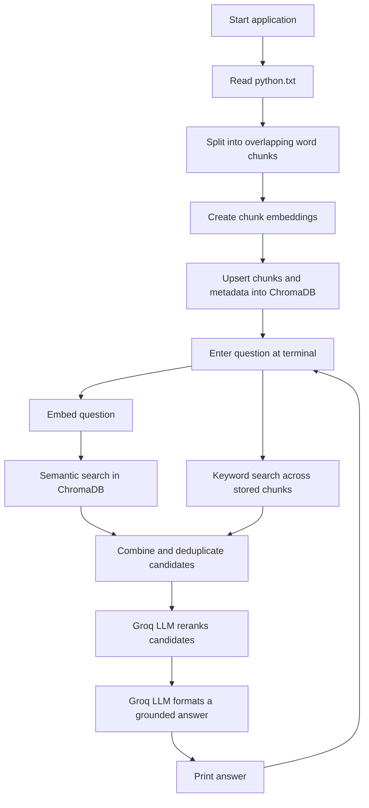
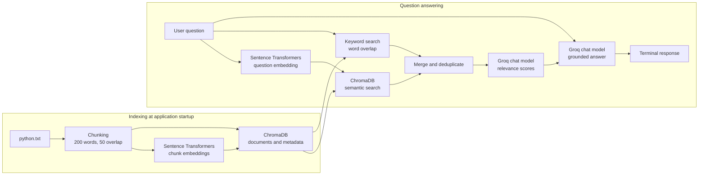

# AI Agent with a Vector Database

A small, terminal-based Retrieval-Augmented Generation (RAG) project. It loads a Python reference document, splits it into overlapping text chunks, embeds and stores those chunks in ChromaDB, then answers questions using retrieved document context.

The project demonstrates a hybrid retrieval pipeline: semantic search and keyword search find candidate chunks, an LLM reranks them, and a final LLM call writes a grounded answer. The answer model is instructed to say when the retrieved text does not contain enough information.

## What the project is intended to do

The goal is to explore how retrieval and language generation can work together:

- Store source text as searchable chunks with embeddings.
- Retrieve relevant content using both semantic similarity and word matches.
- Improve candidate ordering with an LLM-based reranker.
- Generate a readable answer grounded in the retrieved excerpts.

The current knowledge source is `python.txt`. This is a learning prototype, not a production-ready service.

## Components

| Component | Responsibility |
| --- | --- |
| `runner.py` | Loads `python.txt`, indexes it, and runs the interactive question loop. |
| `rag.py` | Splits text into chunks of 200 words with 50-word overlap, creates embeddings, and sends chunks for storage. |
| `embedding.py` | Loads the configured Sentence Transformers model and embeds text. |
| `chromastore.py` | Persists chunks, embeddings, and metadata in the local `chroma_db/` ChromaDB collection; provides semantic search and document retrieval. |
| `keywordSearch.py` | Tokenizes the question and stored chunks and ranks chunks by question-word overlap. |
| `retreiver.py` | Runs both retrieval paths, deduplicates identical chunk text, and coordinates reranking and answer formatting. |
| `reranker.py` | Uses the configured Groq chat model to score each candidate's relevance from 0 to 100. |
| `answer.py` | Asks the Groq chat model to produce a grounded answer from the final candidates, or returns a fallback when there are no candidates. |
| `python.txt` | The current source knowledge document about Python. |

## Request flow



## Architecture



## Example questions and answers

The examples below are based on information present in `python.txt`. Exact wording can vary between model responses.

**Question:** What are NumPy, Pandas, and Matplotlib used for in Python?

**Expected answer:** NumPy supports numerical computing and multidimensional arrays; Pandas provides tools and data structures for data manipulation and analysis; Matplotlib is used to create visualizations such as charts and histograms.

**Question:** Which Python libraries help with working with data and creating charts?

**Expected answer:** NumPy and Pandas support numerical computing and data analysis. Matplotlib and Seaborn are used for visualizations and statistical graphics.

**Question:** Who invented JavaScript?

**Expected answer:** The available excerpts do not contain that information.

## Run locally

### Requirements

- Python 3.12 or newer
- A Groq API key and a Groq chat model available to your account
- Internet access on the first run to download the configured embedding model, and access to the Groq API for reranking and answer generation

### 1. Install dependencies

From the project directory, create and activate a virtual environment, then install the dependencies:

```powershell
py -3.12 -m venv .venv
.\.venv\Scripts\Activate.ps1
python -m pip install --upgrade pip
python -m pip install chromadb groq python-dotenv sentence-transformers
```

Alternatively, if you use `uv`:

```powershell
uv sync
```

### 2. Configure local settings

Create a `.env` file in the project root using your own values. The application reads these setting names:

- `GROQ_API_KEY` — your private Groq API key
- `GROQ_MODEL_NAME` — the Groq chat model name to use
- `EMBEDDING_MODEL` — a Sentence Transformers model identifier

Do not commit `.env` or share its contents. It is ignored by Git. The embedding model is downloaded from Hugging Face when needed; a Hugging Face token is optional unless you need authenticated access or encounter download limits.

### 3. Start the application

Run the command from the project root so `python.txt` and `chroma_db/` resolve correctly:

```powershell
python runner.py
```

With `uv`, run:

```powershell
uv run python runner.py
```

Enter questions at the `USER:` prompt. Type `exit`, `bye`, or `quit` to stop.

## Notes

- The application indexes `python.txt` each time it starts and persists/upserts the resulting chunks in `chroma_db/`.
- The semantic and keyword retrieval paths each return up to three candidates by default; duplicate chunk text is removed before reranking.
- The keyword path checks word overlap. The reranker uses an LLM call for each candidate, followed by another LLM call to format the final answer.
- Keep your API credentials private. Do not paste them into source code, terminal logs, issues, or commits.
